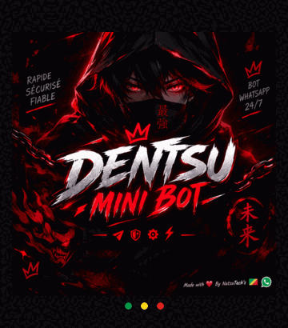

  

<h1 align="center">DENTSU MINI BOT</h1>

  

<strong>A WhatsApp × Telegram assistant by NatsuTech's Dev 🇨🇬 · Alva'sDev</strong>

  
  
  
  

  
  &nbsp;
  

  
  
  

---

## What it does

Dentsu Mini Bot pairs WhatsApp accounts through Telegram or its web pairing page. It includes a large command collection for media downloads, stickers, group tools and everyday utilities.

- Pair a WhatsApp session with a one-time code or QR scan.
- Manage bot sessions from Telegram.
- Welcome and goodbye messages, anti-link and anti-spam controls for groups.
- Serve the pairing page and a <code>/health</code> endpoint from the same Node.js service.

## Run locally

<strong>You need Node.js 20 or newer and a Telegram bot token.</strong>

1. Clone or download the repository.
2. Install dependencies with <code>npm ci</code>.
3. Copy <code>.env.example</code> to <code>.env</code> and set <code>TELEGRAM_BOT_TOKEN</code>.
4. Start the bot with <code>npm start</code>.
5. On Telegram, send <code>/start</code>, then use <code>/pair &lt;international phone number&gt;</code>.

<code>NEXORACLE_API_KEY</code> and <code>OMDB_API_KEY</code> are optional; they enable extra logo and movie features. Keep your <code>.env</code> private and never commit bot tokens or API keys.

## Deploy on Railway

The button opens Railway's project creation page; it does not silently choose a repository. In Railway, select <strong>Deploy from GitHub repo</strong>, then choose <code>helpingdentsu-bot/dentsu-mini-bot</code> or your own fork.

1. Add <code>TELEGRAM_BOT_TOKEN</code> under the service's variables. The other API keys are optional.
2. Add a Railway Volume and mount it at <strong><code>/app/auth_info</code></strong>. This is where the bot stores WhatsApp session files; without persistent storage, a redeploy can require pairing again.
3. Deploy the service and generate a public domain for the pairing page.

<code>railway.json</code> sets <code>npm ci</code>, <code>npm start</code>, the <code>/health</code> check and restart policy. Choose the deployment branch and automatic-deploy behavior in Railway's service settings.

## Deploy on Render

This button deploys the <strong>official repository</strong> using its <code>render.yaml</code> Blueprint. To deploy a fork on Render, create a Blueprint from your fork in the Render Dashboard instead; the button above intentionally points to the official source.

1. Set the required <code>TELEGRAM_BOT_TOKEN</code> when Render prompts for environment variables. <code>NEXORACLE_API_KEY</code> and <code>OMDB_API_KEY</code> are optional.
2. Review the Blueprint before confirming: it selects Render's <strong>Starter</strong> plan and creates a 1 GB persistent disk mounted at <strong><code>/opt/render/project/src/auth_info</code></strong>.
3. After deployment, open the service's public URL to use the pairing page; <code>/health</code> is the health-check endpoint.

The disk preserves WhatsApp session files across restarts. Check Render's current pricing before approving the Starter service. The Blueprint deploys commits from its linked branch automatically.

## License & credits

Released under the [MIT License](LICENSE).

<strong>Built with care by NatsuTech's Dev 🇨🇬 · Alva'sDev</strong>

[GitHub repository](https://github.com/helpingdentsu-bot/dentsu-mini-bot) · [Telegram community](https://t.me/DPLOIEMENT_DUN_BOT2) · [WhatsApp channel](https://whatsapp.com/channel/0029VbC1s7fFnSz1YhZYc01h)
